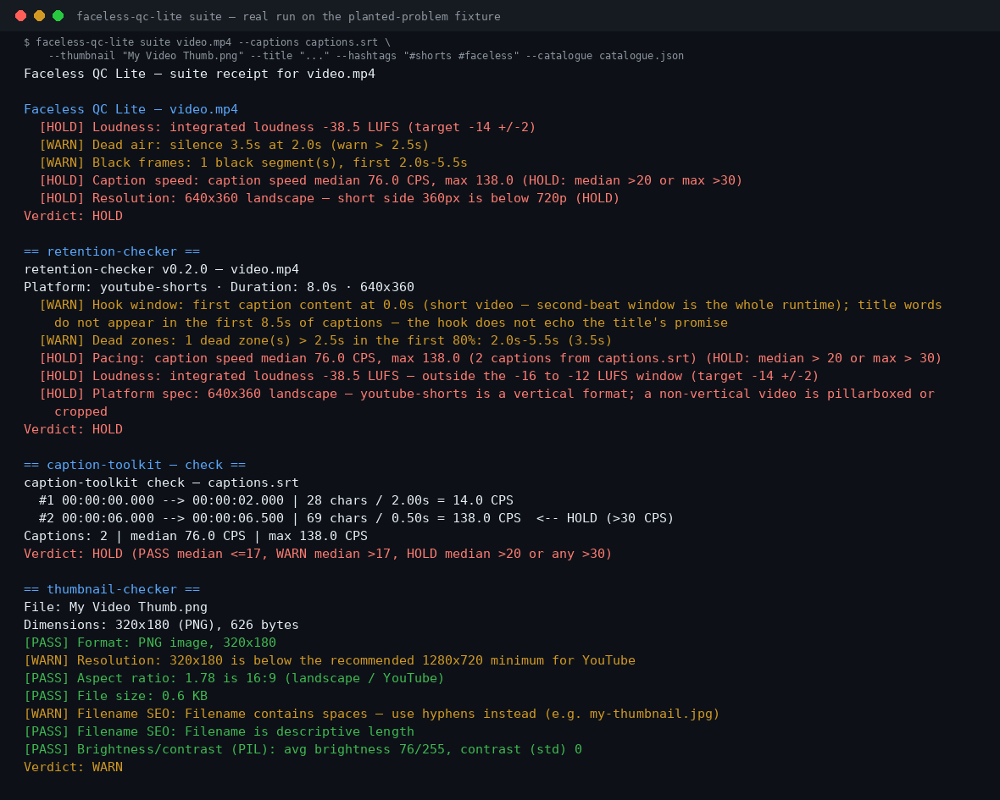

<h1 align="center">faceless-qc-lite</h1>

<p align="center"><strong>Every pre-upload check a faceless creator runs — one command, one receipt.</strong></p>

<p align="center">
  
  
  
  
  
</p>

<p align="center"></p>

A faceless video can fail in six places, and until now
each one had its own tool. The video itself can be too
quiet, gapped, or the wrong size. The captions can race
or arrive structurally broken from raw transcription.
The thumbnail can be 320×180. The Short can bleed its
first seconds. The title can truncate mid-word. The
description links can point at services that shut down
last year.

faceless-qc-lite v1 (2026-10-31) checked the first
place — the video file: loudness, dead air, black
frames, caption speed, resolution. **v2.0.0 is the
merge:** five published tools — caption-toolkit,
thumbnail-checker, retention-checker, shorts-packager,
link-rot — became check modules of this suite. One
install, one pre-upload run, one QC receipt.

Local only: nothing is ever uploaded anywhere, and the
link audit never even fetches a link.

It earns its keep on real files. The run that started
this project, back at v1.0.0:

```
Faceless QC Lite — intro-loop.mp4
  [HOLD] Loudness: integrated loudness -21.6 LUFS (target -14 +/-2)
  [PASS] Dead air: longest in-story silence 0.0s
  [PASS] Black frames: no black segments >= 0.5s
Verdict: HOLD
```

That file was heading for upload 7.6 LUFS too quiet.
Lite caught it in seconds.

## Quick start

```bash
pipx install faceless-qc-lite              # or: pip install faceless-qc-lite
faceless-qc-lite my-video.mp4
faceless-qc-lite suite my-video.mp4 --captions my-video.srt \
    --thumbnail thumb.png --title "My Title" \
    --hashtags "#shorts" --catalogue catalogue.json
```

*(Live on PyPI since v2.0.0. Source checkouts also work:
`python3 src/faceless_qc_lite.py <video>` for the
anchor, or
`pipx install git+https://github.com/jasveerai88/faceless-qc-lite`.)*

Needs Python 3.10+ and **FFmpeg on PATH** (the anchor
and retention checks measure with ffmpeg/ffprobe).
No accounts, no API keys, no dependencies.

The anchor's own command line is unchanged from v1.x —
exit 0 PASS, 2 HOLD, 1 error — so existing pipelines
keep working:

```bash
faceless-qc-lite my-video.mp4
faceless-qc-lite my-video.mp4 --captions my-video.srt
# from a checkout, the anchor still runs exactly as it always has:
python3 src/faceless_qc_lite.py my-video.mp4
```

## What it checks

| Check | Command | What it catches | Verdict words |
|---|---|---|---|
| **The anchor — the video file** | `faceless-qc-lite VIDEO` (or `check VIDEO`) | Loudness vs the −14 LUFS streaming target (±2), longest in-story dead air (warn >2.5s, HOLD >4s), black frames ≥0.5s, caption speed from a `.srt`/`.vtt` sidecar, resolution + orientation | PASS / WARN / HOLD / SKIP |
| **Captions** | `captions check\|fix\|lint\|repair\|convert` | Caption speed gates, plus the structural lint/repair raw transcription output needs (timing, overlaps, malformed cues) | PASS / WARN / HOLD |
| **Thumbnail** | `thumbnail IMAGE` | Real dimensions parsed from the file header, data integrity, aspect ratio, file size, filename SEO | PASS / WARN / FAIL |
| **Retention** | `retention VIDEO` | Hook window, dead zones, pacing, loudness, platform spec (Shorts / long-form / TikTok) on the finished video | PASS / WARN / HOLD |
| **Shorts title** | `package --title T [--hashtags H]` | Fits a Shorts title + hashtags into the 100-visible-character cap, wording untouched — it truncates at a word boundary and says so, or moves hashtags to the description | PASS / PASS_WITH_OVERFLOW / TRUNCATED |
| **Description links** | `links audit\|links CATALOGUE` | Structural rot in a description-link catalogue: placeholder hosts, dead domains, malformed URLs — audited offline, never fetched | findings by class; exit 0 clean / 1 findings |

The combined `suite` run executes the anchor plus every
module that applies to the inputs given. A module with
nothing to run on reports **SKIPPED with its reason** —
a skip is never counted as a pass. Suite verdict: HOLD
if any module HOLDs or FAILs (exit 2), PASS WITH
WARNINGS if any module warns (exit 0), else PASS.
Every module also runs standalone behind the suite
command, and every one accepts `--json` (one object;
the suite's object nests each module's own).

## The receipt — a real run

`examples/make_fixture.py` builds a fixture set with
one planted problem per module: a very quiet 640×360
video with a 3.5s black, silent gap; a captions file
whose second cue races at 138 CPS; a 320×180 thumbnail
with spaces in its filename; an over-100-character
Shorts title; a catalogue holding a goo.gl link and an
example.com placeholder. The run below is captured
output, reproduced verbatim — build the fixture and
diff it yourself.

```bash
faceless-qc-lite suite video.mp4 --captions captions.srt \
    --thumbnail "My Video Thumb.png" \
    --title "I Tried the Hardest Faceless Video Challenge for Thirty Days and the Results Were Honestly Unbelievable" \
    --hashtags "#shorts #faceless" --catalogue catalogue.json
# exit code: 2
```

```
Faceless QC Lite — suite receipt for video.mp4

Faceless QC Lite — video.mp4
  [HOLD] Loudness: integrated loudness -38.5 LUFS (target -14 +/-2)
  [WARN] Dead air: silence 3.5s at 2.0s (warn > 2.5s)
  [WARN] Black frames: 1 black segment(s), first 2.0s-5.5s
  [HOLD] Caption speed: caption speed median 76.0 CPS, max 138.0 (HOLD: median >20 or max >30)
  [HOLD] Resolution: 640x360 landscape — short side 360px is below 720p (HOLD)
Verdict: HOLD

== retention-checker ==
retention-checker v0.2.0 — video.mp4
Platform: youtube-shorts · Duration: 8.0s · 640x360
  [WARN] Hook window: first caption content at 0.0s (short video — second-beat window is the whole runtime); title words do not appear in the first 8.5s of captions — the hook does not echo the title's promise
  [WARN] Dead zones: 1 dead zone(s) > 2.5s in the first 80%: 2.0s-5.5s (3.5s)
  [HOLD] Pacing: caption speed median 76.0 CPS, max 138.0 (2 captions from captions.srt) (HOLD: median > 20 or max > 30)
  [HOLD] Loudness: integrated loudness -38.5 LUFS — outside the -16 to -12 LUFS window (target -14 +/-2)
  [HOLD] Platform spec: 640x360 landscape — youtube-shorts is a vertical format; a non-vertical video is pillarboxed or cropped
Verdict: HOLD

== caption-toolkit — check ==
caption-toolkit check — captions.srt
  #1 00:00:00.000 --> 00:00:02.000 | 28 chars / 2.00s = 14.0 CPS
  #2 00:00:06.000 --> 00:00:06.500 | 69 chars / 0.50s = 138.0 CPS  <-- HOLD (>30 CPS)
Captions: 2 | median 76.0 CPS | max 138.0 CPS
Verdict: HOLD (PASS median <=17, WARN median >17, HOLD median >20 or any >30)

== thumbnail-checker ==
File: My Video Thumb.png
Dimensions: 320x180 (PNG), 626 bytes
[PASS] Format: PNG image, 320x180
[WARN] Resolution: 320x180 is below the recommended 1280x720 minimum for YouTube
[PASS] Aspect ratio: 1.78 is 16:9 (landscape / YouTube)
[PASS] File size: 0.6 KB
[WARN] Filename SEO: Filename contains spaces — use hyphens instead (e.g. my-thumbnail.jpg)
[PASS] Filename SEO: Filename is descriptive length
[PASS] Brightness/contrast (PIL): avg brightness 76/255, contrast (std) 0
Verdict: WARN

== shorts-packager ==
Title (98/100): I Tried the Hardest Faceless Video Challenge for Thirty Days and the Results Were Honestly #shorts
Verdict: TRUNCATED
Hashtags in title: 1 (#shorts)
Hashtags overflow to description: 1 (#faceless)
WARNING: Title alone is 103 chars (> 100) even without hashtags: truncated at a word boundary to 90 chars. Edit the title wording yourself for a better fit.

Description:
---
I Tried the Hardest Faceless Video Challenge for Thirty Days and the Results Were Honestly

#faceless

Credits: [add your sources / credits here]
---

== link-rot — audit ==
link-rot v0.1.0 — audit · catalogue catalogue.json
1 video(s) · 3 link occurrence(s) · 3 unique link(s)
Structural audit only: this tool reads text and never fetches a link.
A finding means the link cannot work as written, or is worth a live
check — never that it was loaded and failed.

Findings by class (findings, not links):
  placeholder: 1
  dead-domain: 1

Cannot work as written: 2 unique link(s)
Worth a live check: 0 unique link(s)
Clean: 1 unique link(s)

Per video:
  [fixture-1] Fixture video
    ! dead-domain — https://goo.gl/abc123 — host goo.gl belongs to a service that has shut down (Google URL Shortener — Google shut it down and its links stopped resolving in August 2025) — an expired-domain risk pattern; replace it with a live target
    ! placeholder — https://example.com/plan — host example.com is a documentation placeholder — the real link was never filled in

Suite verdict: HOLD — needs attention: faceless-qc-lite, retention-checker, caption-toolkit, thumbnail-checker, shorts-packager, link-rot
```

The same command on a clean control (a 720×1280 Short
at −14.0 LUFS with a readable sidecar, and no
`--thumbnail` / `--title` / `--catalogue` given) ends:

```
Suite verdict: PASS WITH WARNINGS — needs attention: faceless-qc-lite (skipped, not passed: thumbnail-checker, shorts-packager, link-rot)
```

— three modules honestly SKIPPED, not passed, and the
exit code is 0.

## The merge — what changed, what didn't

This release executes a fleet audit
(FLEET-AUDIT-2026-11-04): 43 published tools were
audited, and 18 of the quiet ones were ordered merged
into 4 flagships so the fleet would be a few strong
tools instead of dozens of shelf orphans. This is
merge #2; the five absorbed tools became this suite's
check library.

The merge changed no engine: each module's code is
**byte-identical** to its source tool's, its CLI shape
and verdict vocabulary are unchanged, and it still
reports its own source version inside its own output
(caption-toolkit v0.3.0, thumbnail-checker v0.2.0,
retention-checker v0.2.0, shorts-packager v0.2.0,
link-rot v0.1.0) — 2.0.0 is the suite's version. The
anchor's engine is byte-identical to the file that has
shipped in this repo since v1.2.0. The suite's new
code is the dispatcher, the combined `suite` run, and
21 tests on top of the 220 the six source suites
carried over — 241 in total. One harness conversion,
named plainly: the anchor's tests were pytest-style
functions; the same seven checks with the same
assertions are now unittest methods so one discover
run covers everything.

Known note: the engines are installed as top-level
Python modules (`faceless_qc_lite`, `caption_toolkit`,
`thumbnail_checker`, `retention_checker`,
`shorts_packager`, `link_rot`) alongside the
`faceless_qc_suite` dispatcher. If you also installed
one of the original standalone tools, both installs
provide the same module file with identical content —
either copy behaves the same. And because the names
are plain, a same-named `.py` file in the folder you
run from can shadow the installed module; run from a
clean directory if a module ever behaves like someone
else's code.

### For agents

[SKILL.md](SKILL.md) states the full command surface,
each module's verdict vocabulary, the `suite` JSON
contract and the honesty limits — and makes
faceless-qc-lite itself installable as a skill: point
your agent at this repo's SKILL.md and it can run the
pre-upload gate before anything goes public.

## Honest limits

- **FFmpeg is a hard requirement for measurement.**
  Without ffmpeg/ffprobe on PATH, the anchor's and
  retention's media checks cannot measure — they
  report SKIP / error by design. The suite never
  guesses a measurement it couldn't take.
- **Caption speed is a gate, not full caption QA.**
  The anchor judges the median (and the worst cue);
  the per-line percentage gates are part of the full
  Faceless QC (below).
- **The link audit is structural and offline.** Its
  words are "cannot work as written" and "worth
  checking live" — never "dead" and never "works". It
  has not loaded your link and will not.
- **The thumbnail check reads headers, not taste.**
  Dimensions, integrity, aspect, size and filename are
  measured from the file itself (Pillow, when
  installed, additionally verifies the image data and
  measures brightness/contrast; without it those two
  sub-checks skip). Whether the thumbnail is *good* is
  still your eye's job.
- **The packager fits, it does not write.** An
  over-long title is truncated at a word boundary and
  the receipt says so, with the overflow moved to the
  description template. Better wording stays yours.
- **A PASS is a floor, not a forecast.** It means
  "none of the checked problems were found" — never
  "this video will perform".

## The receipt family

One grammar across the fleet — *claims on one side,
evidence on the other, every verdict cited*:

- **[preflight-agent](https://github.com/jasveerai88/preflight-agent)
  — is this agent setup safe to run?** Five static
  auditors over Claude/agent configuration, one scan
  receipt. (Merge #1 of the same audit.)
- **[skill-vet](https://github.com/jasveerai88/skill-vet)
  — is this skill pack dangerous?** Stealing, spying,
  hidden sending, each proven as a combination of
  evidence.
- **[permission-audit](https://github.com/jasveerai88/permission-audit)
  — do your allowlists grant more than you think?**
  Claude Code permission rules, resolved the way the
  tool itself resolves them.
- **[skill-claims](https://github.com/jasveerai88/skill-claims)
  — is the package honest?** A skill's prose promises
  audited against its static behaviour.
- **[spec-receipt](https://github.com/jasveerai88/spec-receipt)
  — does the code still match the spec?** Declared
  surfaces vs implemented surfaces, per-item verdicts.
- **[done-claim-auditor](https://github.com/jasveerai88/done-claim-auditor)
  — did the agent do what it claimed?** The same
  claim-vs-evidence logic pointed at session
  transcripts.

faceless-qc-lite is the family's creator-side member:
the upload is the claim, the measurements are the
evidence.

## Lite vs full Faceless QC

Lite (this repo, free forever, MIT) is the suite
above. The full Faceless QC adds: too-few-pauses
intelligence, full caption gates (% of lines over
speed, not just the median), dynamics (LRA), an HTML
report naming the worst 3 moments with timestamps,
and one-click launchers.

## Sponsor this work

If Lite saves you one bad upload, consider sponsoring
— sponsorships fund new checks and keep Lite free:
use the **Sponsor** button above —
[github.com/sponsors/jasveerai88](https://github.com/sponsors/jasveerai88). What each tier gets, and how to claim
it: [SPONSOR-REWARDS.md](SPONSOR-REWARDS.md).

## Tests

```bash
python3 -m unittest discover -s tests
```

241 tests: the anchor's 7 (pytest-style in v1.x, now
unittest wrappers with identical assertions), the
five module suites carried over (50 + 28 + 53 + 22 +
60 = 213), and 21 dispatcher/suite tests covering
subcommand routing, skip-with-reason reporting, the
combined JSON shape and exit-code ranking. Fixtures
are fictional; the example media under `examples/`
is generated locally by the scripts beside it.

## Privacy

Runs 100% locally. No telemetry, no accounts, no
tracking, nothing uploaded.
