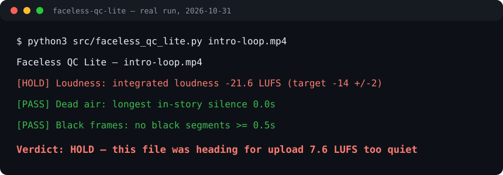

# Faceless QC Lite


**Free pre-upload checker for AI / faceless videos.** Drop in a finished MP4 — get a plain-English PASS / HOLD in seconds. Local only: your video is never uploaded anywhere.

## The 5 free checks
1. **Loudness** — integrated LUFS vs the −14 streaming target (±2).
2. **Dead air** — longest in-story silence (warn >2.5s, HOLD >4s; outro fade excluded).
3. **Black frames** — black segments ≥0.5s in the story.
4. **Caption speed** — median chars/sec from a `.srt`/`.vtt` sidecar (warn >17 CPS, HOLD >20; no sidecar = SKIP, never a fake pass).
5. **Resolution** — frame size + orientation (warn below 1080p short side, HOLD below 720p).

## Use
Needs Python 3.10+ and FFmpeg on PATH. No accounts, no API keys.
```
python3 src/faceless_qc_lite.py my-video.mp4
python3 src/faceless_qc_lite.py my-video.mp4 --captions my-video.srt
```
Exit codes: 0 PASS, 2 HOLD, 1 error — drop it straight into a publish pipeline.



## Real example (our own file, 2026-10-31)
```
Faceless QC Lite — intro-loop.mp4
  [HOLD] Loudness: integrated loudness -21.6 LUFS (target -14 +/-2)
  [PASS] Dead air: longest in-story silence 0.0s
  [PASS] Black frames: no black segments >= 0.5s
Verdict: HOLD
```
That file was heading for upload 7.6 LUFS too quiet. Lite caught it in seconds.

## Why this exists
Built from measured failure data on real faceless channels: videos most often die because they are too quiet, have a dead gap mid-story, or flash black frames — and most creators only find out after upload.

## Lite vs full Faceless QC
Lite (this repo, free forever, MIT) is the 5 checks above.
The full Faceless QC adds: too-few-pauses intelligence, full caption gates (% of lines over speed, not just the median), dynamics (LRA), an HTML report naming the worst 3 moments with timestamps, and one-click launchers.

## Sponsor this work
If Lite saves you one bad upload, consider sponsoring — sponsorships fund new checks and keep Lite free: use the **Sponsor** button above (GitHub Sponsors: @jasveerai88). What each tier gets, and how to claim it: [SPONSOR-REWARDS.md](SPONSOR-REWARDS.md).

## Privacy
Runs 100% locally. No telemetry, no accounts, no tracking, nothing uploaded.
